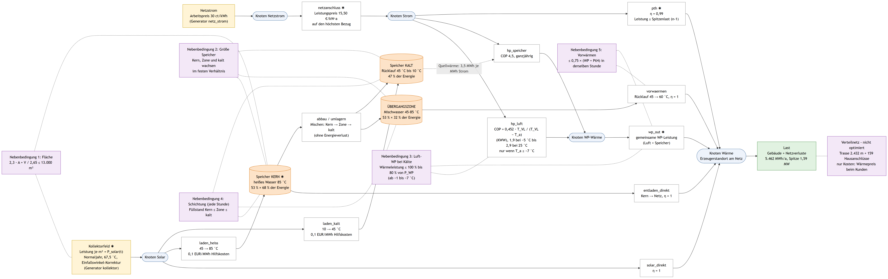
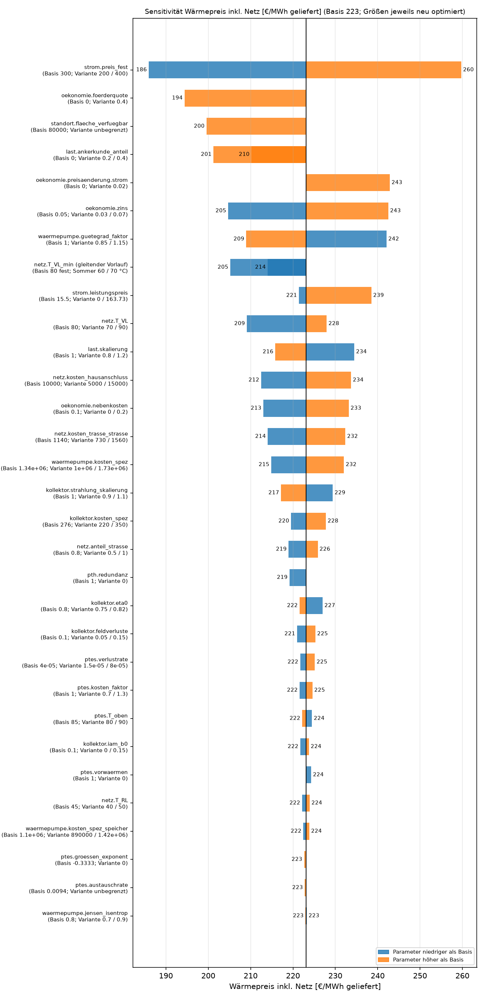
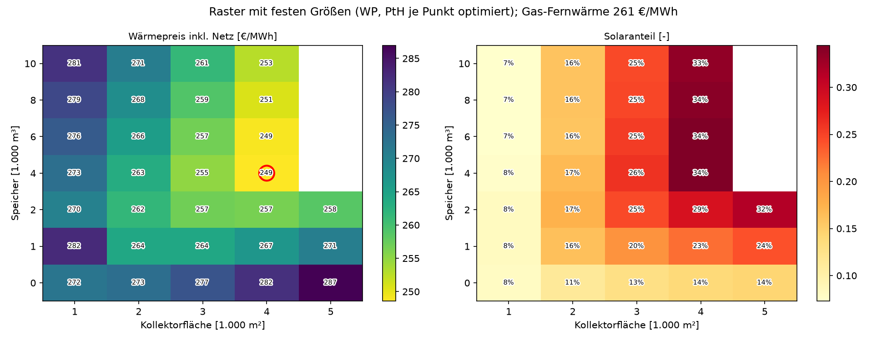
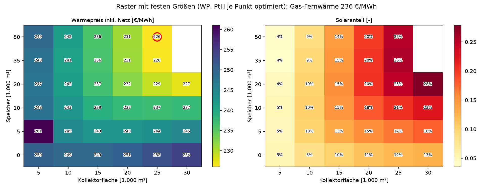

# SERTS – Solares Wärmenetz mit Erdbeckenspeicher, Wärmepumpe und PtH

Studienprojekt SERTS an der TU Berlin (WiSe 2026/27). **Leitfrage:** Was kostet Fernwärme aus Solarthermie,
Erdbeckenspeicher (PTES), Wärmepumpe und Power-to-Heat für ein Wärmenetz einer Kleinstadt – und ist sie günstiger
als Gas-Fernwärme? Das Modell bestimmt dafür die kostenoptimalen Größen aller Anlagen über ein ganzes Jahr
(8760 Stunden). Leitlinie: so simpel wie möglich, so komplex wie nötig.

**Inhalt:** [Die zwei Netze](#die-zwei-netze) · [Das Modell](#das-modell-in-einer-minute) ·
[Eingangsdaten](#wichtigste-eingangsdaten) · [Ergebnisse](#ergebnisse-stand-22112026-vorläufig) ·
[Grenzen](#was-das-modell-nicht-kann) · [Schnellstart](#schnellstart) · [Lizenz und Quellen](#lizenz-und-quellen)

## Die zwei Netze


> **Beispielnetze, keine Planung:** „Bad Lippstadt“ ist eine exemplarische Stadt. Beide Netze hat das Team auf realen,
> offenen Gebäude- und Geodaten von Bad Lippspringe (NRW) entworfen und mit F|Heat berechnet (Trasse,
> Hausanschlüsse, Verluste, stündlicher Lastgang). Dort gibt es kein solches Projekt; die Ergebnisse sind
> Größenordnungen.

| | Netz klein (rot) | Netz groß (gelb) |
|---|---|---|
| Gebäude / Hausanschlüsse | 159 | 877 |
| Wärmebedarf Gebäude (Raumwärme + Warmwasser) | 4.525 MWh/a | 42.783 MWh/a |
| Netzverluste | 935 MWh/a | 5.437 MWh/a |
| Trasse / Hausanschlussleitungen | 2.432 m / 3.413 m | 14.291 m / 16.755 m |
| Spitzenlast (inkl. Verluste) | 1,6 MW | 15,5 MW |
| Freifläche für Kollektor + Speicher | 1,3 ha | 8 ha |
| Vorlauf / Rücklauf | 80 °C / 45 °C (F\|Heat: 50 °C) | 80 °C / 45 °C |

## Das Modell in einer Minute



- **Was wird gesucht?** Kollektorfläche, Speichervolumen, Leistung der Wärmepumpen (Luft und Speicher), PtH-Leistung
  und Netzanschluss – so, dass die **Jahreskosten** (Annuität der Investitionen nach VDI 2067 + Strom + Wartung)
  minimal sind und jede Stunde die Last gedeckt ist.
- **Wie?** Ein lineares Optimierungsmodell in [PyPSA](https://pypsa.org) (Solver HiGHS) über alle 8760 Stunden
  gemeinsam, mit perfekter Voraussicht. Rechenzeit ≈ 4 min je Lauf.
- **Wärmequellen:** Kollektorfeld (Strahlung DWD/PVGIS), Luft-Wärmepumpe (COP abhängig von Außentemperatur),
  Speicher-Wärmepumpe (nutzt den kalten Speicherteil als Quelle), PtH-Heizstab als Reserve und Spitze.
- **Speicher:** drei Schichten – heißer Kern (direkt ins Netz), Übergangszone (Vorwärmen des Rücklaufs) und kalter
  Teil (nur über die Wärmepumpe). So bildet ein lineares Modell Schichtung und Temperaturen ab. Geprüft gegen den
  realen Speicher in Dronninglund (DK): [Validierung](docs/validierung_dronninglund.md).
- **Grenzen der Größe:** Kollektor und Speicher müssen gemeinsam auf die Freifläche passen; die Speicherkosten
  sinken mit der Größe (Kostenkurve in Segmenten).
- **Ergebnis:** Wärmepreis in €/MWh beim Kunden (inkl. Verteilnetz), verglichen mit einer Gas-Fernwärme auf
  demselben Netz.

Ausführlicher: [Modell Schritt für Schritt (Notebook)](notebooks/01_modell_erklaert.ipynb),
[Speichermodell](docs/speichermodell.md), [Systemskizze mit allen Nebenbedingungen](docs/systemskizze.md).

## Wichtigste Eingangsdaten

| Bereich | Annahme (Basis) | Quelle |
|---|---|---|
| Wetter, Last | Jahr 2022, Station DWD 03028; Lastgang aus F\|Heat | DWD, Netzberechnung |
| Strom | 30 ct/kWh fest (inkl. Netzentgelt, Abgaben) + 15,50 €/kW·a Leistungspreis; Variante Day-Ahead | Team, Netzbetreiber |
| Gas-Referenz | 12 ct/kWh + CO₂ 100 €/t | Team, UBA |
| Kollektor | 304 €/m² (groß 276 €/m²), 25 a | KWW Technikkatalog |
| Erdbeckenspeicher | Kostenkurve, z. B. 68 €/m³ bei 60.000 m³, 30 a | KWW Technikkatalog |
| Wärmepumpe Luft / Speicher | 1.340 / 1.100 €/kW | KWW, Team |
| Verteilnetz | Trasse 650 €/m (groß 1.140 €/m) + Hausanschlüsse | KWW Technikkatalog |
| Wirtschaftlichkeit | real, 5 % Zins, 20 a, +10 % Planung, Basis ohne Förderung | Team, VDI 2067 |

Alle Parameter mit Einheit, Status (belegt / Vorgabe / Annahme) und Quelle: [docs/eingangsparameter.md](docs/eingangsparameter.md)
(Übersicht klein/groß) und [docs/annahmen.md](docs/annahmen.md) (vollständig, erzeugt aus `config/base.yaml`).

## Ergebnisse (Stand 22.11.2026, vorläufig)

| | Netz klein | Netz groß |
|---|---|---|
| Kostenoptimum Kollektor / Speicher | 4.670 m² / 6.000 m³ | 29.200 m² / 33.800 m³ |
| Wärmepumpe (Wärmeleistung) / PtH | 1,0 MW / 1,6 MW | 9,7 MW / 15,5 MW |
| **Wärmepreis inkl. Netz** (Gas-Fernwärme) | **245 €/MWh** (261) | **223 €/MWh** (236) |
| mit BEW-Förderung Modul 2 (Obergrenze 40 %) | 210 €/MWh | 194 €/MWh |
| ohne Solar, nur WP + PtH | 278 €/MWh | 255 €/MWh |
| Solaranteil / Speicherzyklen | 41 % / 3,2 pro Jahr | 30 % / 3,9 pro Jahr |
| CO₂ aus Netzstrom (Gas-Fernwärme) | 555 t/a (1.160) | 5.710 t/a (10.200) |

- **Solar + Speicher lohnt sich:** ≈ 31–33 €/MWh günstiger als reine Wärmepumpe + PtH und ≈ 6 % unter Gas-Fernwärme.
- **Der Vorsprung ist knapp:** Strompreis, Effizienz der Luft-WP und Förderung entscheiden. Bei einem 15 % schlechteren
  WP-Gütegrad oder real steigendem Strompreis ist der Vorteil gegenüber Gas weg.
- **Niedriger Vorlauf hilft deutlich:** im Sommer auf 60 °C gleitend −16 bis −18 €/MWh, fest 70 °C −13 bis −14;
  90 °C kostet +5 €/MWh.
- **Die Fläche ist der Engpass:** Ohne Flächengrenze wird ein **Saisonspeicher** am günstigsten (klein: 33.600 m³,
  93 % Solar, −19 €/MWh, ≈ 3,9 ha; groß: −24 €/MWh und mehr). Obergrenze, weil Fläche im Modell nichts kostet.
- **Day-Ahead-Strom** (Stand 15.11.): WP/PtH laden den Speicher in billigen Stunden; mit 2024er Preisen 220 €/MWh
  (Netz klein), selbst mit dem Krisenjahr 2022 bleibt das System unter Gas.

**Woher kommt die Wärme, was kostet sie?** (Netz klein) Rund 40 % der Wärme stammt aus der Sonne (direkt, aus dem
Speicher oder über die Speicher-WP), den Rest liefert die Luft-WP. Größter Kostenblock ist der Strom, danach das Netz.


**Wer deckt wann die Last?** Von Mai bis September deckt Solar mit Speicher (fast) die ganze Last. Bis zum Herbst
wird der Speicher voll geladen und vor allem im Dezember wieder entladen; im Winter läuft sonst die Luft-WP.
Unten: Speicherinhalt nach Schichten und Temperaturen.

| Netz klein | Netz groß |
|---|---|
|  |  |

**Welche Annahme verschiebt das Ergebnis wie stark?** Jeder Balken ist eine Variante, für die alle Größen neu
optimiert wurden; die gestrichelte Linie ist Gas-Fernwärme.

| Netz klein | Netz groß |
|---|---|
|  |  |

**Wie flach ist das Optimum?** Wärmepreis für feste Kombinationen aus Kollektorfläche und Speichervolumen
(Wärmepumpe und PtH je Punkt optimiert; Kreis = bester Rasterpunkt, leere Felder passen nicht auf die Fläche).
Das Optimum ist flach: Im kleinen Netz liegen 4.000 m² Kollektor mit 4.000–10.000 m³ Speicher innerhalb von
4 €/MWh, im großen ist das Feld ab ≈ 20.000 m³ Speicher flach. Mehr Kollektor lohnt nur mit Speicher.

| Netz klein | Netz groß |
|---|---|
|  |  |

Alle Zahlen und Varianten: [docs/ergebnisse.md](docs/ergebnisse.md) (klein), [docs/ergebnisse_netz_gross.md](docs/ergebnisse_netz_gross.md)
(groß). Warum welche Modellentscheidung: [docs/entscheidungen.md](docs/entscheidungen.md).

## Was das Modell nicht kann

- **Perfekte Voraussicht** über das Jahr: der Speicher wird optimal bewirtschaftet, ein realer Betrieb schafft
  etwas weniger.
- **Ein Wetter- und Lastjahr (2022)**; keine Unsicherheit über Jahre.
- **Netz nicht optimiert:** Trasse, Verluste und Temperaturen kommen fest aus F|Heat; das Netz geht nur als Kosten ein.
- **Speichertemperaturen vereinfacht** (drei Schichten statt Strömungsmodell); Fläche kostet nichts.
- **Kosten** aus Katalogwerten (KWW), keine Angebote; Förderung nur als Obergrenze.

Mehr: [docs/modellgrenzen.md](docs/modellgrenzen.md), [docs/unsicherheiten.md](docs/unsicherheiten.md),
Einordnung gegen die Literatur: [docs/vergleich_schauss2026.md](docs/vergleich_schauss2026.md).

## Schnellstart

Einmalig [Git](https://git-scm.com) und [uv](https://docs.astral.sh/uv/) installieren, dann:

```bash
git clone https://github.com/EricBenno/serts_wise2627.git serts
cd serts
uv sync                      # Python 3.12 + exakt die Paketversionen aus uv.lock in .venv
uv run serts verify-raw      # Prüfsummen der Rohdaten
uv run pytest                # Tests
uv run serts prepare         # Zeitreihen 8760 h -> data/processed/
uv run serts run             # Basislauf Netz klein: Größen optimieren, Kennzahlen + Grafiken (≈ 4 min)
```

Weitere Befehle (`uv run serts --help`):

```bash
uv run serts run --netz gross  # großes Netz; Ergebnisse getrennt in results/gross/
uv run serts run --V 0         # Variante ohne Speicher (weitere Optionen: --A, --szenario, --stunden)
uv run serts varianten         # Basis / ohne Speicher / nur WP+PtH / mit BEW (+ Gas), ≈ 10 min
uv run serts heatmap           # Raster Kollektorfläche x Speichervolumen
uv run serts tornado           # Sensitivitäten (≈ 1,5 h je Netz)
uv run serts annahmen          # docs/annahmen.md aus config/base.yaml erzeugen
uv run serts uebersicht        # docs/eingangsparameter.md erzeugen
uv run serts offen             # Liste der offenen Parameter
```

Annahmen ändern: Wert in `config/base.yaml` anpassen (oder ein Szenario in `config/scenarios/` anlegen und mit
`--szenario name` rechnen). Jeder Lauf legt `results/<netz>/<zeit>_<szenario>_<art>/` mit Config-Kopie und Git-Hash an.

## Struktur

```
config/base.yaml            alle Parameter: wert, einheit, status (belegt|vorgabe|annahme|offen), quelle
config/netze/gross.yaml     Netzfall "gross" (Lastgang, Trasse, Fläche); Netz "klein" = Basis
config/scenarios/*.yaml     nur Abweichungen zur Basis (kombinierbar: --szenario a+b)
data/raw/                   Rohdaten unverändert (Prüfsummen in data/raw/MANIFEST.sha256)
data/reference/             Referenzwerte Dronninglund (Validierung)
docs/                       Ergebnisse, Entscheidungen, Annahmen (generiert), Modellgrenzen
src/serts/                  Paket: network.py (PyPSA-Modell), constraints.py (Zusatzbedingungen),
                            economics.py (Kosten), kpi.py (Auswertung), run/heatmap/tornado/varianten.py
tests/                      pytest (Mini-Netz je Nebenbedingung)
notebooks/                  nur Auswertung und Erklärung, keine Logik
```

Stand und nächste Schritte: [docs/struktur.md](docs/struktur.md), [docs/ausblick.md](docs/ausblick.md).
Passt das Modell zur Leitfrage? [docs/kernfragen.md](docs/kernfragen.md). BEW-Förderung: [docs/foerderung_bew.md](docs/foerderung_bew.md).
**Interne Quellenkürzel:** `BRF`, `SCH` und `TEAM` in `config/base.yaml` und `docs/` verweisen auf nicht
veröffentlichte Arbeitsunterlagen des Teams (Briefing, Modellschema, Teamabsprachen). Pfade wie `../Bad Lippspringe`
meinen den Team-Ordner neben dem Repo; alle für die Rechnung nötigen Daten liegen in `data/raw/`.

## Mitarbeiten

Lesen und klonen kann jede Person; pushen nur eingeladene Personen (Repo-Besitzer: *Settings → Collaborators*).
Vor dem Arbeiten `git pull`, größere Änderungen auf einem eigenen Branch und als Pull Request in `main`.
Vor dem ersten Commit `git config user.email` auf die eigene GitHub-noreply-Adresse setzen (GitHub → Settings →
Emails), da Commits öffentlich sind.

Was im Repo liegt: Code, Config, Doku, alle Rohdaten. Nicht im Repo: `.venv` (nie mitkopieren, entsteht per
`uv sync`), `data/processed/` (per `serts prepare`) und `results/` (reproduzierbar; die Grafiken oben liegen als
Kopie in `docs/img/`). Ohne GitHub (z. B. Abgabe als Zip): `git archive --format=zip -o serts.zip HEAD`.

## Lizenz und Quellen

Code: [MIT](LICENSE). Doku und Ergebnisse (`docs/`): CC BY 4.0, Namensnennung „Eric Dieterle & SERTS-Projektteam, TU Berlin“.
Mitgelieferte Daten Dritter behalten ihre eigenen Bedingungen; bei Weiterverwendung die Quelle nennen:

| Daten | Quelle |
|---|---|
| Wetter (Temperatur, Strahlung, Boden), Station 03028 | Deutscher Wetterdienst (DWD), Climate Data Center; Datenlizenz Deutschland – Namensnennung 2.0 |
| Strahlung auf Kollektorebene, TMY | © Europäische Union, JRC, PVGIS (SARAH-3) |
| Day-Ahead-Strompreise DE-LU | Bundesnetzagentur \| SMARD.de, CC BY 4.0 (Abruf über Energy-Charts, Fraunhofer ISE) |
| Kosten Kollektor, Speicher, WP, Trasse | KWW Technikkatalog Wärmeplanung (Version 1.1, 08/2026), Kompetenzzentrum Kommunale Wärmewende, CC BY 4.0 |
| Gebäude, Flurstücksnutzung (Grundlage der Netze) | Land NRW, Geobasis NRW (ALKIS) |
| Wärmebedarf je Gebäude (Raumwärme + Warmwasser), Wärmedichte | Land NRW, LANUV: Planungsgrundlagen Kommunale Wärmeplanung NRW (Raumwärmebedarfsmodell, Kommunenpaket 05774008) |
| Straßennetz (Trassenführung) | © OpenStreetMap-Mitwirkende, ODbL 1.0 |
| Netzberechnung (Trasse, Hausanschlüsse, Verluste, Lastgang) | eigene Berechnung des Teams mit F\|Heat auf Basis der Zeilen oben |
| Luftbild in der Netzkarte | Esri World Imagery (Esri, Maxar, Earthstar Geographics) |
| Referenzwerte Dronninglund | Winterscheid & Schmidt, Solites 2019 (Monitoringbericht); Sifnaios et al. 2023, Solar Energy 251 |

Weitere Kennwerte (Kosten, Wirkungsgrade, Förderung) sind je Parameter mit Quelle in `config/base.yaml` belegt,
Übersicht: [docs/annahmen.md](docs/annahmen.md).
