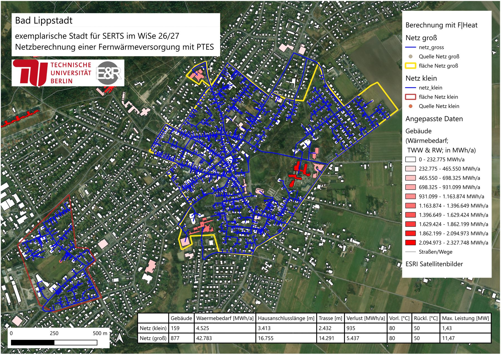
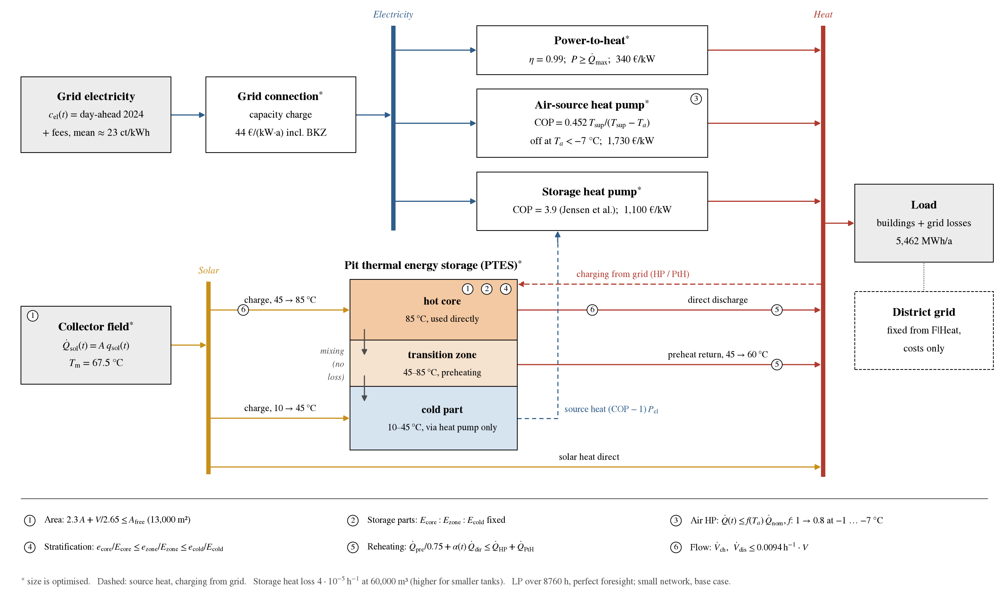
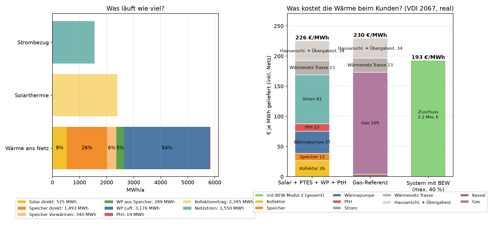
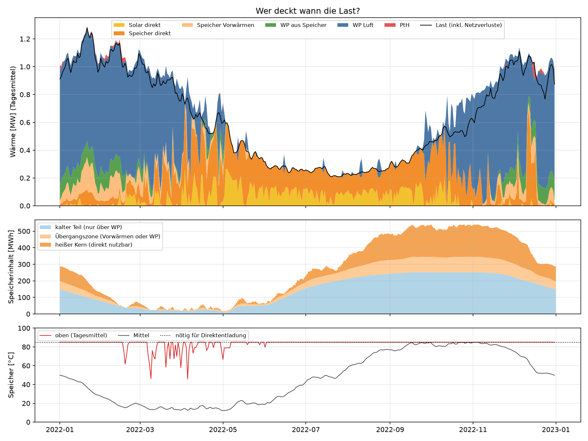
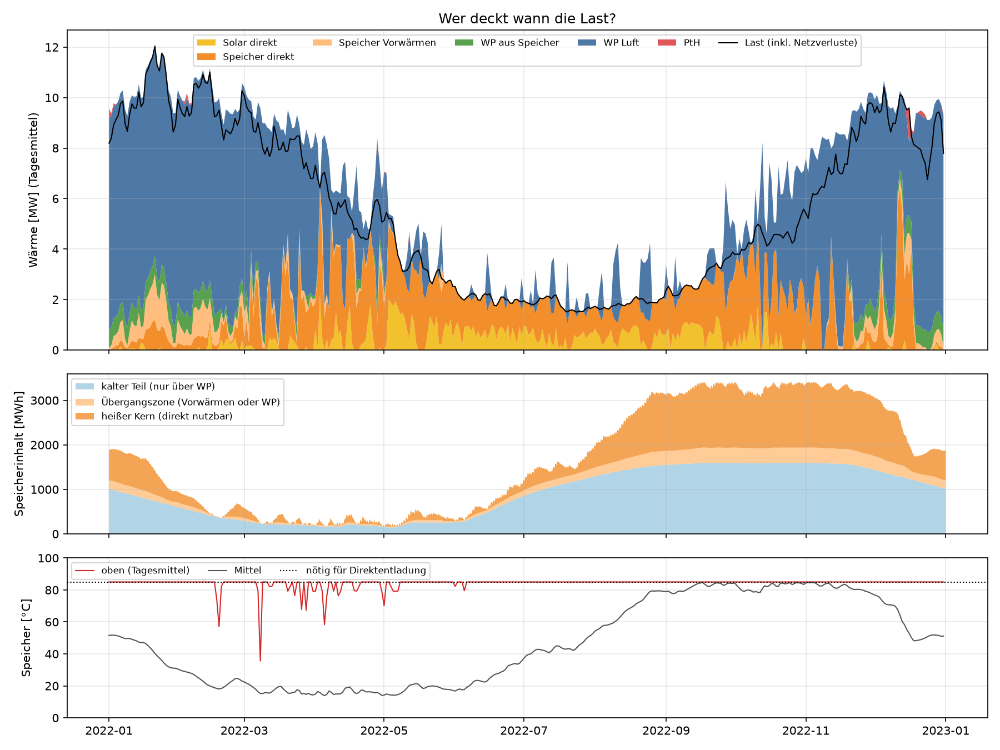
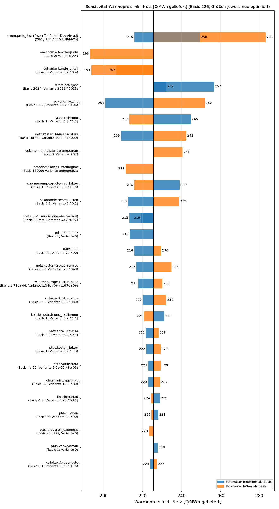

# SERTS – Solar district heating with pit thermal energy storage, heat pump and power-to-heat

Student project SERTS at TU Berlin (winter term 2026/27). **Guiding question:** What does district heat from solar
thermal, a pit thermal energy storage (PTES), heat pumps and power-to-heat cost for the heating network of a small
town – and is it cheaper than gas-fired district heating? The model finds the cost-optimal size of every plant over a
full year (8760 hours).

**Contents:** [The two networks](#the-two-networks) · [The model](#the-model-in-one-minute) ·
[Key inputs](#key-inputs) · [Results](#results) · [Limitations](#what-the-model-cannot-do) ·
[Quick start](#quick-start) · [Licence and sources](#licence-and-sources)

Code, config keys and parts of `docs/` are in German (e.g. `netz` = network, `klein`/`gross` = small/large,
`waermepumpe` = heat pump, `speicher` = storage); the CLI help explains every command.

## The two networks



> "Bad Lippstadt" was chosen as an example. The team designed both networks on real, open building and geodata of
> Bad Lippspringe (NRW, Germany) and calculated them with F|Heat (route, house connections, losses, hourly load).

| | Small network (red) | Large network (yellow) |
|---|---|---|
| Buildings / house connections | 159 | 877 |
| Building heat demand (space heating + hot water) | 4,525 MWh/a | 42,783 MWh/a |
| Network losses | 935 MWh/a | 5,437 MWh/a |
| Route / house connection pipes | 2,432 m / 3,413 m | 14,291 m / 16,755 m |
| Peak load (incl. losses) | 1.6 MW | 15.5 MW |
| Free area for collectors + storage | 1.3 ha | 8 ha |
| Supply / return temperature | 80 °C / 45 °C (F\|Heat: 50 °C) | 80 °C / 45 °C |

## The model in one minute



- **What is optimised?** Collector area, storage volume, heat pump capacity (air-source and storage), PtH capacity
  and grid connection – so that the **annual cost** (annuity of investments per VDI 2067 + electricity + O&M) is
  minimal and the load is met in every hour.
- **How?** A linear optimisation model in [PyPSA](https://pypsa.org) (solver HiGHS) over all 8760 hours at once,
  with perfect foresight. About 4 min per run.
- **Heat sources:** collector field (irradiance DWD/PVGIS), air-source heat pump (COP depends on outdoor
  temperature), storage heat pump (uses the cold part of the storage as its source), PtH electric boiler as back-up
  and peak.
- **Electricity:** hourly day-ahead price plus supplier margin, grid fee and levies, so heat pump and PtH can charge
  the storage in cheap hours; plus a capacity charge on the highest hourly grid draw.
- **Storage:** three layers – hot core (directly into the network), transition zone (preheating the return) and cold
  part (only via the heat pump). This way a linear model captures stratification and temperatures. Checked against
  the real storage in Dronninglund (DK): [validation](docs/validierung_dronninglund.md).
- **Size limits:** collector and storage must fit on the free area together; storage cost per m³ falls with size
  (cost curve in segments).
- **Result:** heat price in €/MWh at the customer (incl. distribution network), compared with gas-fired district
  heating on the same network.

More detail (German): [model step by step (notebook)](notebooks/01_modell_erklaert.ipynb),
[storage model](docs/speichermodell.md), [system sketch with all constraints](docs/systemskizze.md).

## Key inputs

| Area | Base assumption | Source |
|---|---|---|
| Weather, load | Year 2022, DWD station 03028; hourly load from F\|Heat | DWD, network calculation |
| Electricity | Day-ahead 2024 + margin 2.5 + grid fee 7.99 + levies 4.8 ct/kWh (mean ≈ 23 ct/kWh); capacity charge 44 €/(kW·a) incl. connection fee (BKZ) | SMARD, grid operator price sheets, BNetzA monitoring report 2025 |
| Electricity scenario | Fixed tariff 20 / 30 / 40 ct/kWh | Assumption |
| Gas reference | 12 ct/kWh incl. CO₂ price (scenarios 6 / 8 / 10 / 14 ct/kWh) | Assumption |
| Collector | 304 €/m² (large: 276 €/m²), 25 a | KWW technology catalogue |
| PTES | Cost curve, e.g. 68 €/m³ at 60,000 m³, 30 a | KWW technology catalogue |
| Air-source heat pump | 1,730 €/kW (large: 1,340 €/kW) | KWW technology catalogue |
| Storage heat pump / PtH | 1,100 €/kW / 340 €/kW (large: 180 €/kW) | KWW technology catalogue |
| Distribution network | Route 650 €/m (large: 1,140 €/m) + house connections | KWW technology catalogue |
| Economics | Real terms, 4 % interest, 20 a, +10 % planning, base without subsidy | Assumption, VDI 2067 |

Every parameter with unit, status (`belegt` = sourced / `vorgabe` = model setting / `annahme` = assumption) and
source: [docs/eingangsparameter.md](docs/eingangsparameter.md) (overview small/large) and
[docs/annahmen.md](docs/annahmen.md) (complete, generated from `config/base.yaml`).

## Results

As of 24.11.2026 (decisions E43/E44), preliminary.

| | Small network | Large network |
|---|---|---|
| Cost optimum collector / storage | 4,635 m² / 6,200 m³ | 28,350 m² / 39,200 m³ |
| Heat pump (heat output) / PtH | 0.9 MW / 1.6 MW | 9.1 MW / 15.5 MW |
| **Heat price incl. network** (gas district heating) | **226 €/MWh** (230) | **189 €/MWh** (207) |
| with BEW subsidy module 2 (upper bound 40 %) | 193 €/MWh | 164 €/MWh |
| without solar, heat pump + PtH only | 260 €/MWh | 224 €/MWh |
| Solar share / storage cycles | 41 % / 3.8 per year | 29 % / 4.8 per year |
| CO₂ from grid electricity (gas district heating) | 563 t/a (1,156) | 5,770 t/a (10,200) |

- **Solar + storage pays off:** 34–35 €/MWh cheaper than heat pump + PtH alone in both networks.
- **Against gas it depends on the network size:** the large network is 18 €/MWh (9 %) below gas district heating,
  the small one only 4 €/MWh (2 %), i.e. at parity. In the small network a 6 % interest rate, a 15 % worse heat
  pump, the 2023 price year or a fixed 30 ct/kWh tariff each make it more expensive than gas; the large network only
  loses its lead with gas below ≈ 11 ct/kWh, the crisis prices of 2022 or a fixed tariff of 30 ct/kWh.
- **Electricity price and interest rate move the result most:** a fixed tariff of 20 / 30 / 40 ct/kWh instead of
  day-ahead gives −10 / +24 / +58 €/MWh (small network), interest 2 % / 6 % −25 / +26 €/MWh. The BEW subsidy saves
  about 33 €/MWh.
- **Day-ahead price is used actively:** heat pump and PtH charge the storage in cheap hours (mainly in autumn);
  the electricity they buy costs 225 instead of 231 €/MWh on average (large network: 221).
- **Lower supply temperature helps:** sliding to 60 °C in summer −12 to −14 €/MWh, fixed 70 °C −10 to −11;
  90 °C costs +4 €/MWh.
- **Area is the bottleneck:** without an area limit a **seasonal storage** is cheapest (small network: 33,600 m³,
  93 % solar, −14 €/MWh; large network: −12 €/MWh). Upper bound, because land costs nothing in the model.
- **PtH as full back-up costs** about 12 €/MWh (small) and 7 €/MWh (large) compared with PtH sized only as needed.

**Where does the heat come from, what does it cost?** (small network) The air-source heat pump supplies about half
of the heat; storage and collector field (direct, preheating, via the storage heat pump) the rest. The storage
holds solar heat and, with day-ahead prices, also heat-pump heat from cheap hours. The largest cost item is
electricity, followed by the network.



**Who covers the load when?** From May to September solar with storage covers (almost) the whole load. In autumn
the air-source heat pump also charges the storage in cheap hours; the storage is emptied mainly in December and
January, otherwise the air-source heat pump runs in winter. Bottom: storage content by layer and temperatures.

| Small network | Large network |
|---|---|
|  |  |

**Which assumption shifts the result how much?** Each bar is a variant for which all sizes were optimised again
(blue: parameter lower than the base, orange: higher). Gas district heating for comparison: 230 €/MWh (small),
207 €/MWh (large).

| Small network | Large network |
|---|---|
|  |  |

**How flat is the optimum?** Heat price for fixed combinations of collector area and storage volume (heat pump and
PtH optimised per point; circle = best grid point, empty cells do not fit on the area). The optimum is flat: in the
small network 4,000 m² collector with 4,000–10,000 m³ storage are within 1 €/MWh; in the large network the field is
flat from ≈ 20,000 m³ storage. More collector area only pays off with storage.

| Small network | Large network |
|---|---|
|  |  |

All numbers and variants (German): [docs/ergebnisse.md](docs/ergebnisse.md) (small),
[docs/ergebnisse_netz_gross.md](docs/ergebnisse_netz_gross.md) (large). Why each modelling decision was taken:
[docs/entscheidungen.md](docs/entscheidungen.md).

## What the model cannot do

- **Perfect foresight** over the year: the storage is operated optimally (also against the day-ahead price); real
  operation achieves somewhat less.
- **One weather and load year (2022)**; no uncertainty across years.
- **Network not optimised:** route, losses and temperatures are fixed from F|Heat; the network only enters as cost.
- **Simplified storage temperatures** (three layers instead of a flow model); land costs nothing.
- **Costs** from catalogue values (KWW), not quotes; subsidy only as an upper bound.

More (German): [docs/modellgrenzen.md](docs/modellgrenzen.md), [docs/unsicherheiten.md](docs/unsicherheiten.md),
comparison with the literature: [docs/vergleich_schauss2026.md](docs/vergleich_schauss2026.md).

## Quick start

Install [Git](https://git-scm.com) and [uv](https://docs.astral.sh/uv/) once, then:

```bash
git clone https://github.com/EricBenno/serts_wise2627.git serts
cd serts
uv sync                      # Python 3.12 + exactly the package versions from uv.lock in .venv
uv run serts verify-raw      # checksums of the raw data
uv run pytest                # tests
uv run serts prepare         # time series 8760 h -> data/processed/
uv run serts run             # base run small network: optimise sizes, KPIs + plots (≈ 4 min)
```

More commands (`uv run serts --help`):

```bash
uv run serts run --netz gross  # large network; results separately in results/gross/
uv run serts run --V 0         # variant without storage (more options: --A, --szenario, --stunden)
uv run serts run --szenario strom_fest  # fixed electricity price 30 ct/kWh instead of day-ahead
uv run serts varianten         # base / no storage / heat pump + PtH only / with BEW subsidy (+ gas), ≈ 10 min
uv run serts heatmap           # grid of collector area x storage volume
uv run serts tornado           # sensitivities (≈ 1.5 h per network)
uv run serts annahmen          # generate docs/annahmen.md from config/base.yaml
uv run serts uebersicht        # generate docs/eingangsparameter.md
uv run serts offen             # list of open parameters
```

Changing an assumption: edit the value in `config/base.yaml` (or create a scenario in `config/scenarios/` and run
with `--szenario name`). Every run creates `results/<network>/<time>_<scenario>_<type>/` with a copy of the config
and the git hash.

## Structure

```
config/base.yaml            all parameters: wert (value), einheit (unit), status, quelle (source)
config/netze/gross.yaml     network case "gross" (load, route, area, size-dependent costs); "klein" = base
config/scenarios/*.yaml     only deviations from the base (combinable: --szenario a+b)
data/raw/                   raw data unchanged (checksums in data/raw/MANIFEST.sha256)
data/reference/             reference values Dronninglund (validation)
docs/                       results, decisions, assumptions (generated), limitations
src/serts/                  package: network.py (PyPSA model), constraints.py (extra constraints),
                            economics.py (costs), kpi.py (evaluation), run/heatmap/tornado/varianten.py
tests/                      pytest (mini network per constraint)
notebooks/                  evaluation and explanation only, no logic
```

Status and next steps: [docs/struktur.md](docs/struktur.md), [docs/ausblick.md](docs/ausblick.md).
Does the model answer the guiding question? [docs/kernfragen.md](docs/kernfragen.md). BEW subsidy:
[docs/foerderung_bew.md](docs/foerderung_bew.md).
**Internal source tags:** `BRF`, `SCH` and `TEAM` in `config/base.yaml` and `docs/` refer to unpublished working
documents of the team (briefing, model scheme, team agreements); values backed only by these are marked as
assumptions (`annahme`). Paths like `../Bad Lippspringe` mean the team folder next to the repo; all data needed for
the calculation are in `data/raw/`.

## Contributing

Anyone can read and clone; only invited people can push (repo owner: *Settings → Collaborators*).
Run `git pull` before working; larger changes on a branch of their own and as a pull request into `main`.
Before the first commit, set `git config user.email` to your GitHub noreply address (GitHub → Settings → Emails),
since commits are public.

In the repo: code, config, docs, all raw data. Not in the repo: `.venv` (never copy it, `uv sync` creates it),
`data/processed/` (via `serts prepare`) and `results/` (reproducible; the figures above are copied to `docs/img/`).
Without GitHub (e.g. submission as zip): `git archive --format=zip -o serts.zip HEAD`.

## Licence and sources

Code: [MIT](LICENSE). Docs and results (`docs/`): CC BY 4.0, attribution "Eric Dieterle & SERTS project team, TU Berlin".
Third-party data shipped with the repo keep their own terms; name the source when reusing them:

| Data | Source |
|---|---|
| Weather (temperature, irradiance, soil), station 03028 | Deutscher Wetterdienst (DWD), Climate Data Center; Datenlizenz Deutschland – Namensnennung 2.0 |
| Irradiance on collector plane, TMY | © European Union, JRC, PVGIS (SARAH-3) |
| Day-ahead electricity prices DE-LU | Bundesnetzagentur \| SMARD.de, CC BY 4.0 (retrieved via Energy-Charts, Fraunhofer ISE) |
| Levies on electricity | Bundesnetzagentur / Bundeskartellamt, Monitoringbericht Energie 2025 |
| Costs of collector, storage, heat pump, PtH, route | KWW Technikkatalog Wärmeplanung (version 1.1, 08/2026), Kompetenzzentrum Kommunale Wärmewende, CC BY 4.0 |
| Buildings, land use (basis of the networks) | Land NRW, Geobasis NRW (ALKIS) |
| Heat demand per building (space heating + hot water), heat density | Land NRW, LANUV: Planungsgrundlagen Kommunale Wärmeplanung NRW (space heating demand model, municipal package 05774008) |
| Street network (routing) | © OpenStreetMap contributors, ODbL 1.0 |
| Network calculation (route, house connections, losses, load) | own calculation of the team with F\|Heat based on the rows above |
| Aerial image in the network map | Esri World Imagery (Esri, Maxar, Earthstar Geographics) |
| Reference values Dronninglund | Winterscheid & Schmidt, Solites 2019 (monitoring report); Sifnaios et al. 2023, Solar Energy 251 |

Further values (costs, efficiencies, subsidy) are documented per parameter with source in `config/base.yaml`,
overview: [docs/annahmen.md](docs/annahmen.md).
