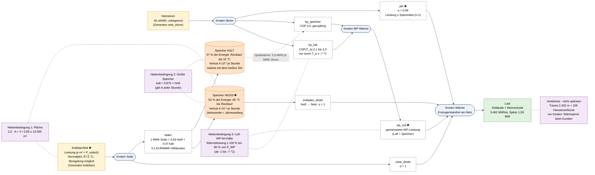

# Systemskizze – so wie das Modell rechnet

Diese Skizze entspricht 1:1 `src/serts/network.py` (Komponenten, Wirkungsgrade) und `src/serts/constraints.py`
(Zusatzbedingungen), Stand nach E27. Rechtecke = Komponenten (PyPSA-Links/Generatoren), Stadien/Kreise = Knoten
(Busse), Zylinder = Speicher. **✱ = Größe wird vom Solver optimiert.** Die Optimierung läuft über alle 8760 Stunden
gemeinsam (perfekte Voraussicht).

## Was die Skizze (nicht) enthält

- **Zeitlich variabel je Stunde:** Last, Außentemperatur → COP und Leistungsfaktor der Luft-WP, Kollektorleistung,
  (fester) Strompreis.
- **Fest je Lauf:** alle Wirkungsgrade, Preise, T_oben/Rücklauf/T_unten, Verlustrate, Fläche.
- **Optimiert (✱):** Kollektorfläche, Speichervolumen (innerhalb des gewählten Kostensegments), WP-Leistung,
  PtH-Leistung (mindestens Spitzenlast). Alle Verbindungen (Links) sind ansonsten nicht in der Leistung begrenzt.
- **Speicher:** Beladen füllt immer beide Teile im Verhältnis 53 : 47 (Wasser von 10 auf 85 °C). Direkt ins Netz
  geht nur der heiße Teil, die Wärmepumpe holt ihre Quellwärme aus dem kalten Teil. Das ersetzt die frühere
  Jahresregel („Direktanteil ≤ 53 %“) und die Monatsbeschränkung (E27).
- **Nicht im Modell:** Wärmeübertrager-Grenzen, Transmissionsleitung, Mischung/Zwischentemperaturen im Speicher,
  WP lädt den Speicher (rechnet sich bei festem Strompreis nicht, siehe `docs/ausblick.md`), Teillast der WP,
  Frostschutz des Kollektorfelds, Stagnation, Netzhydraulik, Leistungspreis für Strom.
- **Kostenseite (nicht in der Skizze):** Jahreskosten nach VDI 2067 je Komponente (inkl. 10 % Nebenkosten) + Strom
  (getrennt in Energie, Netzentgelt, Abgaben); Verteilnetz und Gas-Referenz werden in `kpi.py`/`economics.py`
  zugerechnet (`docs/entscheidungen.md` E25, E28).
