# Systemskizze – so wie das Modell rechnet

Diese Skizze entspricht 1:1 `src/serts/network.py` (Komponenten, Wirkungsgrade) und `src/serts/constraints.py`
(Zusatzbedingungen), Stand nach E41 (Netz klein, Basislauf 6.000 m³; Netz groß: Zahlen siehe
`docs/eingangsparameter.md`). Rechtecke = Komponenten (PyPSA-Links/Generatoren), Stadien/Kreise = Knoten
(Busse), Zylinder = Speicher. **✱ = Größe wird vom Solver optimiert.** Die Optimierung läuft über alle 8760 Stunden
gemeinsam (perfekte Voraussicht). Bild: `docs/systemskizze.png` (aus diesem Mermaid-Code erzeugt).

```mermaid
flowchart LR
    NS["Netzstrom<br/>Arbeitspreis 30 ct/kWh<br/>(Generator netz_strom)"]
    ANS["netzanschluss ✱<br/>Leistungspreis 15,50 €/kW·a<br/>auf den höchsten Bezug"]
    KOL["Kollektorfeld ✱<br/>Leistung je m² = P_solar(t)<br/>Normaljahr, 67,5 °C, Einfallswinkel-Korrektur<br/>(Generator kollektor)"]

    NETZB(["Knoten Netzstrom"])
    ELEC(["Knoten Strom"])
    SOLAR(["Knoten Solar"])
    SPH[("Speicher KERN ✱<br/>heißes Wasser 85 °C<br/>53 % × 68 % der Energie")]
    SPU[("ÜBERGANGSZONE<br/>Mischwasser 45–85 °C<br/>53 % × 32 % der Energie")]
    SPK[("Speicher KALT<br/>Rücklauf 45 °C bis 10 °C<br/>47 % der Energie")]
    WPBL(["Knoten Luft-WP"])
    WPBS(["Knoten Speicher-WP"])
    W(["Knoten Wärme<br/>Erzeugerstandort am Netz"])
    LAST["Last<br/>Gebäude + Netzverluste<br/>5.462 MWh/a, Spitze 1,59 MW"]

    SOLD["solar_direkt<br/>η = 1"]
    LADH["laden_heiss<br/>45 → 85 °C<br/>0,1 EUR/MWh Hilfskosten"]
    LADK["laden_kalt<br/>10 → 45 °C<br/>0,1 EUR/MWh Hilfskosten"]
    ENT["entladen_direkt<br/>Kern → Netz, η = 1<br/>(unter VL + 5 K nur mit Nachheizen)"]
    VOR["vorwaermen<br/>Rücklauf 45 → 60 °C, η = 1"]
    MIX["abbau / umlagern<br/>Mischen: Kern → Zone → kalt<br/>(ohne Energieverlust)"]
    HPL["hp_luft<br/>COP = 0,452 · T_VL / (T_VL − T_a)<br/>(KWW), 1,9 bei −5 °C bis 2,9 bei 25 °C<br/>nur wenn T_a ≥ −7 °C"]
    HPS["hp_speicher<br/>COP nach Jensen et al.: 3,9<br/>(Senke 45→80 °C, Quelle 27,5→21,5 °C)"]
    WPOL["wp_luft_out ✱<br/>Luft-WP 1.340 €/kW"]
    WPOS["wp_speicher_out ✱<br/>Speicher-WP 1.100 €/kW"]
    PTH["pth ✱<br/>η = 0,99<br/>Leistung ≥ Spitzenlast (n-1)"]

    NS --> NETZB --> ANS --> ELEC
    KOL --> SOLAR
    SOLAR --> SOLD --> W
    SOLAR --> LADH --> SPH
    SOLAR --> LADK --> SPK
    SPH --> ENT --> W
    SPU --> VOR --> W
    SPH --> MIX
    MIX --> SPU
    MIX --> SPK
    ELEC --> HPL --> WPBL --> WPOL --> W
    ELEC --> HPS --> WPBS --> WPOS --> W
    SPK -. "Quellwärme: 2,9 MWh je MWh Strom" .-> HPS
    ELEC --> PTH --> W
    W --> LAST

    C1["Nebenbedingung 1: Fläche<br/>2,3 · A + V / 2,65 ≤ 13.000 m²"]
    C2["Nebenbedingung 2: Größe Speicher<br/>Kern, Zone und kalt wachsen<br/>im festen Verhältnis"]
    C3["Nebenbedingung 3: Luft-WP bei Kälte<br/>Wärmeleistung ≤ 100 % bis 80 % von P_WP_Luft<br/>(ab −1 bis −7 °C)"]
    C4["Nebenbedingung 4: Schichtung (jede Stunde)<br/>Füllstand Kern ≤ Zone ≤ kalt"]
    C5["Nebenbedingung 5: Nachheizen<br/>Vorwärmen / 0,75 + α(t) × Direktentladung<br/>≤ WP + PtH in derselben Stunde<br/>(α = 0 bei T_oben ≥ VL + 5 K)"]
    C6["Nebenbedingung 6: Durchfluss<br/>Volumenstrom je Richtung ≤ 0,0094/h × V<br/>(Dronninglund 2014)"]
    C1 -.- KOL
    C1 -.- SPH
    C2 -.- SPH
    C2 -.- SPU
    C2 -.- SPK
    C3 -.- HPL
    C3 -.- WPOL
    C4 -.- SPH
    C4 -.- SPU
    C4 -.- SPK
    C5 -.- VOR
    C5 -.- ENT
    C5 -.- WPOL
    C5 -.- WPOS
    C6 -.- LADH
    C6 -.- ENT

    NETZ["Verteilnetz - nicht optimiert<br/>Trasse 2.432 m + 159 Hausanschlüsse<br/>nur Kosten: Wärmepreis beim Kunden"]
    LAST -.- NETZ

    classDef bus fill:#eef3fb,stroke:#4e79a7,color:#000
    classDef quelle fill:#fff4d6,stroke:#c89b00,color:#000
    classDef speicher fill:#fde3c8,stroke:#d9730d,color:#000
    classDef link fill:#ffffff,stroke:#888,color:#000
    classDef regel fill:#f3e8f7,stroke:#8e44ad,color:#000
    classDef last fill:#e1f2e1,stroke:#3b8a3b,color:#000
    class NETZB,ELEC,SOLAR,WPBL,WPBS,W bus
    class NS,KOL quelle
    class SPH,SPU,SPK speicher
    class ANS,SOLD,LADH,LADK,ENT,VOR,MIX,HPL,HPS,WPOL,WPOS,PTH link
    class C1,C2,C3,C4,C5,C6,NETZ regel
    class LAST last
```

## Was die Skizze (nicht) enthält

- **Zeitlich variabel je Stunde:** Last, Außentemperatur → COP und Leistungsfaktor der Luft-WP, Kollektorleistung,
  Strompreis (fest oder Day-Ahead).
- **Fest je Lauf:** alle Wirkungsgrade, Preise, T_oben/Rücklauf/T_unten, Fläche. Verlustrate und Anteil der
  Übergangszone hängen von der Speichergröße ab (bei 6.000 m³: 8,6·10⁻⁵ je Stunde, 32 %; bei optimiertem Volumen
  der Wert der Untergrenze des Kostensegments).
- **Optimiert (✱):** Kollektorfläche, Speichervolumen (innerhalb des gewählten Kostensegments), Leistung von
  Luft-WP und Speicher-WP (getrennte Maschinen, E41),
  PtH-Leistung (mindestens Spitzenlast), Netzanschlussleistung (= höchster Strombezug). Alle anderen
  Verbindungen (Links) sind nicht in der Leistung begrenzt; Laden/Entladen des Speichers begrenzt der Durchfluss
  (Nebenbedingung 6).
- **Speicher (E39, `docs/speichermodell.md`):** Laden getrennt nach Temperaturband; direkt ins Netz geht nur der
  heiße Kern, die Übergangszone wärmt vor oder geht über `umlagern` an die WP, der kalte Teil nur über die WP.
  Speichertemperaturen oben/Mittel in den Grafiken folgen aus den Füllständen.
- **Nur in Szenarien:** `laden_netz` (WP/PtH laden den Kern, Day-Ahead-Szenarien), gleitender Vorlauf
  (`vl_gleitend`, wirkt auf den COP der Luft-WP).
- **Nicht im Modell:** Wärmeübertrager-Grenzen, Transmissionsleitung, Abkühlen des heißen Wassers (Verluste
  kosten Menge, nicht Temperatur), Laden des kalten Teils bei niedrigerer Kollektortemperatur, Teillast der WP,
  Frostschutz des Kollektorfelds, Stagnation, Netzhydraulik.
- **Kostenseite (nicht in der Skizze):** Jahreskosten nach VDI 2067 je Komponente (inkl. 10 % Nebenkosten) + Strom
  (getrennt in Energie, Netzentgelt, Abgaben, Leistungspreis); Verteilnetz und Gas-Referenz werden in
  `kpi.py`/`economics.py` zugerechnet (`docs/entscheidungen.md` E25, E28, E39).
