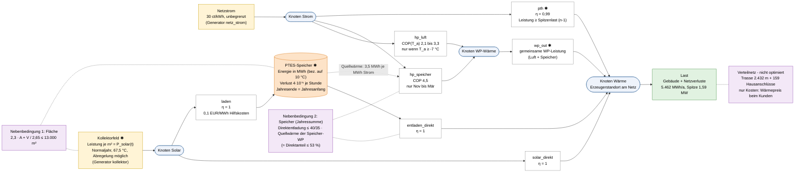

# Systemskizze – so wie das Modell rechnet

Diese Skizze entspricht 1:1 `src/serts/network.py` (Komponenten, Wirkungsgrade) und `src/serts/constraints.py`
(Zusatzbedingungen). Rechtecke = Komponenten (PyPSA-Links/Generatoren), Stadien/Kreise = Knoten (Busse).
**✱ = Größe wird vom Solver optimiert.** Die Optimierung läuft über alle 8760 Stunden gemeinsam (perfekte Voraussicht).

## Was die Skizze (nicht) enthält

- **Zeitlich variabel je Stunde:** Last, Außentemperatur → COP Luft, Kollektorleistung, (fester) Strompreis.
- **Fest je Lauf:** alle Wirkungsgrade, Preise, T_oben/Rücklauf/T_unten, Verlustrate, Fläche.
- **Optimiert (✱):** Kollektorfläche, Speichervolumen (innerhalb der gewählten Preisstufe), WP-Leistung,
  PtH-Leistung (mindestens Spitzenlast). Alle Verbindungen (Links) sind ansonsten nicht in der Leistung begrenzt.
- **Nicht im Modell:** Wärmeübertrager-Grenzen, Transmissionsleitung, Speichertemperaturen/Schichtung,
  Teillast der WP, Frostschutz des Kollektorfelds, Stagnation, Netzhydraulik.
- **Kostenseite (nicht in der Skizze):** Jahreskosten nach VDI 2067 je Komponente + Strom; Verteilnetz und
  Gas-Referenz werden in `kpi.py`/`economics.py` zugerechnet (siehe `docs/entscheidungen.md` E25).
